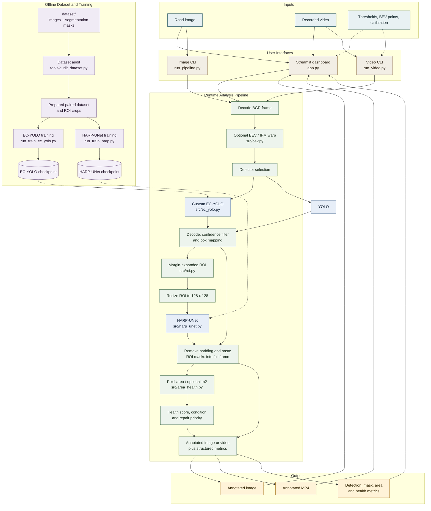

# Project Architecture Diagram

This diagram shows the implemented runtime and offline training paths for the pothole road-health project. Solid arrows are data flow; dashed arrows are model-loading or configuration relationships.

## Runtime sequence

1. A dashboard upload or CLI input supplies an image or video frame.
2. The pipeline optionally rectifies the frame with BEV/IPM, then runs either custom EC-YOLO or the optional Ultralytics detector.
3. Detector boxes are mapped back to source-image coordinates and expanded into ROIs.
4. Each ROI is resized to 128 x 128 for HARP-UNet, matching the ROI-training transform. The predicted binary masks are resized to the crop and restored to full-frame coordinates. Full-image inference remains available for its matching checkpoint.
5. Pixel area is always calculated. Physical area is calculated only when metres-per-pixel calibration is provided.
6. The health module produces the score, condition, and repair priority used by the dashboard or annotated output.

The offline path audits paired image/mask files, prepares YOLO and segmentation data, trains both models, and supplies their checkpoints to the runtime pipeline.